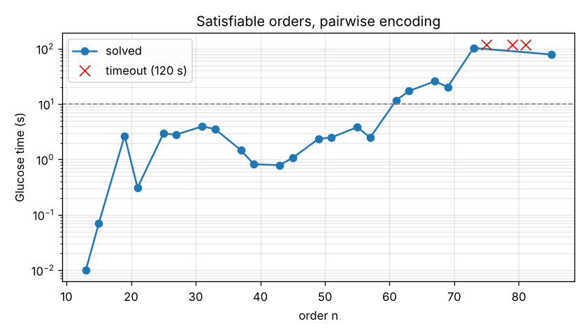

# Steiner triple systems via SAT

This is a project for Propositional and Predicate Logic (NAIL062). The Python script `steiner_sat.py` encodes the problem of finding a Steiner triple system ([CSPLib, problem 044](https://www.csplib.org/Problems/prob044/)) into a CNF formula, solves it with a SAT solver and decodes the result back into a list of triples.

The SAT solver used is [Glucose 4.2.1](https://github.com/audemard/glucose/releases/tag/4.2.1). I compiled it from the source code using

```
cmake .
make
```

This creates the executables `glucose-simp` (the sequential solver) and `glucose-syrup` (the parallel one). The script uses `glucose-simp` and expects it in the same directory as the script, but another path can be given with `-s`. Everything was tested on macOS (it should also work on Linux; on Windows I recommend WSL). Only the Python standard library is used.

The problem is already a decision problem: for a given number $n$, we ask whether a Steiner triple system of order $n$ exists. If it does, the script also prints one.

# Documentation

## Problem description

We have $n$ points $V = \{1, 2, \ldots, n\}$. A *Steiner triple system* of order $n$ is a set $B$ of 3-element subsets of $V$ (called triples) such that **every pair of distinct points is contained in exactly one triple** of $B$.

- Parameter: a positive integer $n$.
- Question: does there exist a set $B \subseteq \binom{V}{3}$ such that for every pair $\{i, j\} \subseteq V$ with $i \neq j$ there is exactly one triple $t \in B$ with $\{i, j\} \subseteq t$?

CSPLib states the problem a bit differently: find $n(n-1)/6$ triples such that any two triples have at most one point in common. This is the same thing. Two triples sharing two points would share a pair, so "at most one common point" means that no pair is covered twice. Then $n(n-1)/6$ triples cover $3 \cdot n(n-1)/6 = \binom{n}{2}$ different pairs, which is all of them. In the other direction, if every pair is covered exactly once, there must be $\binom{n}{2}/3 = n(n-1)/6$ triples.

It is known (Kirkman, 1847) that a Steiner triple system of order $n$ exists if and only if $n \equiv 1$ or $3 \pmod 6$. The "only if" part is easy: the number of triples $n(n-1)/6$ has to be an integer, and every point $p$ is in $n-1$ pairs which are split into triples through $p$ two at a time, so $n-1$ has to be even. The script does **not** use this fact; the SAT solver has to find the answer on its own. This means we know the correct answer for every instance in advance, which is useful for testing.

An example of the input format is a file containing just the order:

```
7
```

## Encoding

For every triple $a < b < c$ of points we have a variable $x_{a,b,c}$, which is true if and only if the triple $\{a, b, c\}$ is in $B$. This gives $\binom{n}{3}$ variables. They are numbered from 1 in lexicographic order of the triples, i.e. $x_{1,2,3} = 1$, $x_{1,2,4} = 2$, and so on.

For a pair $i < j$ let $T(i,j)$ be the set of the $n-2$ triples that contain both $i$ and $j$. We use the following constraints:

- Every pair is covered by at least one chosen triple

    $\bigvee_{t \in T(i,j)} x_t$ for each $i < j$

- Every pair is covered by at most one chosen triple

    $\neg x_s \vee \neg x_t$ for each $i < j$ and each two different triples $s, t \in T(i,j)$

A satisfying assignment gives a Steiner triple system (take the triples whose variables are true), and a Steiner triple system gives a satisfying assignment (set exactly its triples to true), so the formula is satisfiable if and only if the answer is yes.

The formula has $\binom{n}{3}$ variables and $\binom{n}{2}\left(1 + \binom{n-2}{2}\right)$ clauses, so the number of clauses grows like $n^4/8$. For example, $n = 67$ gives 47,905 variables and 4,601,091 clauses. Two special cases: for $n = 1$ there are no pairs, so the formula is empty and satisfiable (the empty set of triples works). For $n = 2$ the only pair $\{1,2\}$ has no triple containing it, so the "at least one" clause is the empty clause (a line with just `0` in DIMACS) and the formula is unsatisfiable.

### Alternatives

The script can also use two other options, which I tried in the experiments below.

- **Sequential counter** (`-e sequential`). The "at most one" constraint with pairwise clauses needs $\binom{k}{2}$ clauses for $k$ triples. The sequential counter ([Sinz, 2005](https://www.carstensinz.de/papers/CP-2005.pdf)) adds helper variables $s_1, \ldots, s_{k-1}$, where $s_m$ means "one of the first $m$ triples is chosen", and uses the clauses

    $\neg x_1 \vee s_1$, $\quad \neg x_k \vee \neg s_{k-1}$, $\quad$ and for $1 < m < k$: $\neg x_m \vee s_m$, $\neg s_{m-1} \vee s_m$, $\neg x_m \vee \neg s_{m-1}$.

    This is only $3k - 4$ clauses but $k - 1$ new variables per pair. For $n = 67$ we get 189,409 variables and 424,512 clauses, so the CNF file is about 10 times smaller.

- **Symmetry breaking** (`--symmetry`). If we rename the points of a Steiner triple system, we get another one. Point 1 lies in $(n-1)/2$ triples, and these split the points $2, \ldots, n$ into pairs. After renaming we can assume that these triples are $\{1,2,3\}, \{1,4,5\}, \{1,6,7\}, \ldots$, so we add them as unit clauses. This does not change whether the formula is satisfiable, but the solver has much less to search.

- **CSPLib formulation.** We could also directly say "choose exactly $n(n-1)/6$ triples and no two chosen triples share two points". The second part gives the same clauses as our "at most one" constraint, and the first part needs a cardinality constraint (e.g. a counter over all $\binom{n}{3}$ variables), so it is bigger and more complicated. I did not implement it.

## User documentation

Basic usage:

```
steiner_sat.py [-h] [-i INPUT] [-n ORDER] [-o OUTPUT] [-s SOLVER] [-v {0,1}] [-e {pairwise,sequential}] [--symmetry] [-p]
```

Command-line options:

* `-h`, `--help`: Show a help message and exit.
* `-i INPUT`, `--input INPUT`: The instance file. Default: "input.in".
* `-n ORDER`, `--order ORDER`: The order $n$ given directly on the command line (then no input file is read).
* `-o OUTPUT`, `--output OUTPUT`: Output file for the DIMACS format (i.e. the CNF formula). Default: "formula.cnf".
* `-s SOLVER`, `--solver SOLVER`: The SAT solver to be used. Default: "./glucose-simp".
* `-v {0,1}`, `--verb {0,1}`: Verbosity. With `-v 1` the script prints the whole output of Glucose (including its statistics about the search) and then the size of the formula and the encoding and solving times. Default: 0.
* `-e {pairwise,sequential}`, `--encoding {pairwise,sequential}`: The encoding of the "at most one" constraints. Default: "pairwise".
* `--symmetry`: Add the symmetry breaking clauses.
* `-p`, `--print-cnf`: Print the CNF formula in DIMACS format to the standard output.

The input file contains one positive integer, the order $n$. For example:

```
python3 steiner_sat.py -i instances/sts-7.in
python3 steiner_sat.py -n 9 -v 1
python3 steiner_sat.py -i instances/sts-6.in -p
```

The output for `instances/sts-7.in` looks like this:

```
##################################################################
#########[ Human readable result: Steiner triple system ]#########
##################################################################

SAT: a Steiner triple system of order 7 exists.
It has 7 triples:

  {1, 2, 4}  {1, 3, 6}  {1, 5, 7}  {2, 3, 5}  {2, 6, 7}  {3, 4, 7}
  {4, 5, 6}

Check: every pair of points is in exactly one triple - OK
```

Each `{a, b, c}` is one triple of the system. The last line is a check done in Python directly on the decoded triples. It takes the three pairs inside every triple, sorts them and compares the result with the list of all pairs, so every pair has to be there exactly once. This check does not depend on the encoding being correct. If there is no solution, the script prints `UNSAT: there is no Steiner triple system of order n.`

## Example instances

* `sts-1.in`, `sts-2.in`: The two special cases from above (empty formula, SAT; empty clause, UNSAT).
* `sts-6.in`: A small unsatisfiable instance (20 variables, 105 clauses). It is easy to see why by hand: point 1 is in 5 pairs, every triple containing point 1 covers exactly 2 of them, and 5 is odd.
* `sts-7.in`: A small satisfiable instance (35 variables, 231 clauses). The solution is the Fano plane with 7 triples, and it is easy to check by hand that all 21 pairs are covered exactly once (see the output above).
* `sts-9.in`: A small satisfiable instance with $n \equiv 3 \pmod 6$ (12 triples).
* `sts-11.in`: An unsatisfiable instance which is small (165 variables, 2,035 clauses) but surprisingly hard: Glucose needed about 100 seconds to prove that there is no solution. With `--symmetry` it is solved immediately. See the experiments.
* `sts-13.in`, `sts-19.in`, `sts-31.in`, `sts-61.in`: Satisfiable instances of growing size.
* `sts-67.in`: A satisfiable instance that takes a nontrivial amount of time, about 25 seconds for Glucose on my machine (4.6 million clauses).

## Experiments

Experiments were run on an Intel Xeon CPU (2.1 GHz, 2 cores) with 8 GB RAM on Ubuntu 24.04, with Python 3.13 and `glucose-simp` 4.2.1. The script `experiments.py` runs the experiments, measures the time of the encoding (building the CNF in Python and writing the DIMACS file) and the time of Glucose (including reading the file), and saves the results as CSV files into `results/`. Every setting was run only once with a time limit of 120 seconds, so consider these toy experiments: the times of a SAT solver can change a lot after a small change of the input.

```
python3 experiments.py -x sat -c results/sat.csv
python3 experiments.py -x unsat -c results/unsat.csv
python3 experiments.py -x encodings -c results/encodings.csv
python3 plot.py
```

(`plot.py` needs `matplotlib`, it is only used for the picture below.)

### How large an instance can we solve?

We try all orders $n \equiv 1, 3 \pmod 6$ from 7 to 85 with the default (pairwise) encoding.

| *n* | *variables* | *clauses* | *result* | *encoding (s)* | *Glucose (s)* |
|---:|---:|---:|:---:|---:|---:|
|  7 |     35 |        231 | SAT | 0.00 | 0.00 |
|  9 |     84 |        792 | SAT | 0.00 | 0.00 |
| 13 |    286 |      4,368 | SAT | 0.00 | 0.01 |
| 15 |    455 |      8,295 | SAT | 0.01 | 0.07 |
| 19 |    969 |     23,427 | SAT | 0.02 | 2.68 |
| 21 |  1,330 |     36,120 | SAT | 0.02 | 0.31 |
| 25 |  2,300 |     76,200 | SAT | 0.05 | 2.93 |
| 27 |  2,925 |    105,651 | SAT | 0.08 | 2.82 |
| 31 |  4,495 |    189,255 | SAT | 0.14 | 3.95 |
| 33 |  5,456 |    246,048 | SAT | 0.18 | 3.54 |
| 37 |  7,770 |    396,936 | SAT | 0.28 | 1.47 |
| 39 |  9,139 |    494,247 | SAT | 0.34 | 0.82 |
| 43 | 12,341 |    741,363 | SAT | 0.54 | 0.79 |
| 45 | 14,190 |    894,960 | SAT | 0.70 | 1.07 |
| 49 | 18,424 |  1,272,432 | SAT | 1.04 | 2.35 |
| 51 | 20,825 |  1,500,675 | SAT | 1.32 | 2.50 |
| 55 | 26,235 |  2,047,815 | SAT | 1.82 | 3.83 |
| 57 | 29,260 |  2,371,656 | SAT | 2.06 | 2.49 |
| 61 | 35,990 |  3,132,960 | SAT | 2.94 | 11.65 |
| 63 | 39,711 |  3,575,943 | SAT | 3.33 | 17.27 |
| 67 | 47,905 |  4,601,091 | SAT | 4.36 | 25.82 |
| 69 | 52,394 |  5,189,352 | SAT | 4.73 | 20.45 |
| 73 | 62,196 |  6,533,208 | SAT | 6.52 | 103.32 |
| 75 | 67,525 |  7,295,475 | timeout | 7.21 | > 120 |
| 79 | 79,079 |  9,018,087 | timeout | 9.03 | > 120 |
| 81 | 85,320 |  9,985,680 | timeout | 9.37 | > 120 |
| 85 | 98,770 | 12,152,280 | SAT | 11.56 | 78.76 |



Up to about $n = 57$ every instance is solved in a few seconds, from $n = 61$ it takes more than 10 seconds, and $n = 73$ took almost two minutes. The times are not monotone at all: $n = 19$ was slower than $n = 43$, and $n = 85$ was solved while 75, 79 and 81 were not. It seems that for satisfiable instances the solver is sometimes "lucky" and finds a solution quickly. Another limit is memory: the pairwise encoding has about $n^4/8$ clauses and the script keeps the whole CNF in memory (around 0.8 GB for $n = 67$), so with 8 GB of RAM it would not get much further than $n \approx 100$ anyway. So in a reasonable time (under a minute) we can solve orders up to about 70.

### Unsatisfiable instances

For $n \not\equiv 1, 3 \pmod 6$ the answer is always UNSAT. We run them with and without symmetry breaking.

| *n* | *n mod 6* | *variables* | *clauses* | *Glucose (s)* | *with `--symmetry` (s)* |
|---:|:---:|---:|---:|---:|---:|
|  4 | 4 |     4 |     12 | 0.00 | 0.00 |
|  5 | 5 |    10 |     40 | 0.00 | 0.00 |
|  6 | 0 |    20 |    105 | 0.00 | 0.00 |
|  8 | 2 |    56 |    448 | 0.00 | 0.00 |
| 10 | 4 |   120 |  1,305 | 0.01 | 0.00 |
| 11 | 5 |   165 |  2,035 | **100.77** | 0.01 |
| 12 | 0 |   220 |  3,036 | 0.02 | 0.00 |
| 14 | 2 |   364 |  6,097 | 1.70 | 0.00 |
| 16 | 4 |   560 | 11,040 | 19.90 | 0.00 |
| 17 | 5 |   680 | 14,416 | > 120 | > 120 |
| 18 | 0 |   816 | 18,513 | > 120 | 0.01 |
| 20 | 2 | 1,140 | 29,260 | > 120 | 0.01 |
| 22 | 4 | 1,540 | 44,121 | > 120 | 0.03 |
| 23 | 5 | 1,771 | 53,383 | > 120 | > 120 |

This was the most interesting result. The unsatisfiable instances are much harder than the satisfiable ones of the same size: without symmetry breaking, Glucose could not prove UNSAT for any $n \geq 17$, while satisfiable instances with $n = 69$ (50 times more variables) took 20 seconds. The reason is that the proof of UNSAT is a counting argument (some number is odd, or not divisible by 3), and such arguments are known to be hard for resolution-based solvers. The argument depends on $n$ (mod 6), which explains the difference between the rows:

- For even $n$, the point 1 is in an odd number $n - 1$ of pairs, and they cannot be split into triples two at a time. With symmetry breaking we already fixed which triples contain point 1, so the solver finds the contradiction immediately. That is why all even orders become trivial.
- For $n \equiv 5 \pmod 6$ (like 11, 17, 23), $n - 1$ is even, so the symmetry breaking does not help with this argument. The real reason is that the number of pairs $\binom{n}{2}$ is not divisible by 3. Symmetry breaking helped for $n = 11$, but $n = 17$ and $23$ still time out.

### Comparison of the encodings

We compare the pairwise and the sequential encoding, both with and without symmetry breaking, on satisfiable orders. The numbers are Glucose times in seconds.

| *n* | *clauses (pairwise)* | *clauses (sequential)* | *pairwise* | *pairwise + sym.* | *sequential* | *sequential + sym.* |
|---:|---:|---:|---:|---:|---:|---:|
| 19 |    23,427 |   8,208 |  2.81 |  0.19 |   0.01 | 0.01 |
| 31 |   189,255 |  39,060 |  3.95 |  2.89 |   0.05 | 0.04 |
| 43 |   741,363 | 108,360 |  0.76 |  0.62 |   0.47 | 0.28 |
| 55 | 2,047,815 | 231,660 |  3.81 |  9.08 |   3.52 | 19.05 |
| 61 | 3,132,960 | 318,420 | 11.40 | 27.05 |  35.70 | 22.61 |
| 67 | 4,601,091 | 424,512 | 25.30 | 44.67 | 103.26 | 9.68 |

The sequential encoding has about 10 times fewer clauses, so the encoding in Python is about 10 times faster (0.4 s instead of 4.4 s for $n = 67$) and it uses much less memory. For small orders it is also much faster to solve. For the larger orders there is no clear winner: the times jump around between the settings, and the same option can help for one $n$ and hurt for another (e.g. symmetry breaking with the sequential encoding: 19 s instead of 3.5 s for $n = 55$, but 9.7 s instead of 103 s for $n = 67$). Symmetry breaking does not seem to help with satisfiable instances in general, but it helps a lot with the unsatisfiable ones. I kept the pairwise encoding as the default because it is the simplest one and the mapping between variables and triples is direct.